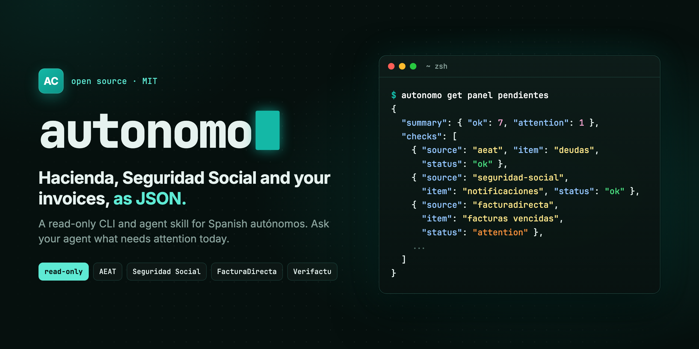

<p align="center">
  
</p>

<p align="center">
  <a href="https://github.com/mejiasd3v/autonomo-cli/actions/workflows/ci.yml"></a>
  <a href="LICENSE"></a>
  
  
  <a href="skills/autonomo/SKILL.md"></a>
  
</p>

# autonomo

Read-only CLI and agent skill for the data of a Spanish autónomo:
FacturaDirecta, Agencia Tributaria (AEAT) and Seguridad Social. JSON output.

Ask your agent *"¿tengo algo pendiente con Hacienda o la Seguridad Social?"*
and it runs `autonomo get panel pendientes`: debts, unread notifications,
alerts, your next RETA cuota and overdue invoices, in one answer.

- **Read-only by construction.** The HTTP layer refuses write requests. The
  few POSTs that are pure queries must be marked as such. Nothing can file,
  pay, sign or send.
- **Never opens a notification.** Opening one counts as legal receipt and
  starts deadlines. autonomo only reads the lists.
- **Your certificate stays yours.** Re-encrypted with AES-256, password in the
  OS keyring, decrypted key never written to disk in clear.
- **No telemetry.** Requests go only to AEAT, Seguridad Social and
  FacturaDirecta.

## Install

Needs Python 3.11+ and [uv](https://docs.astral.sh/uv/).

```sh
git clone https://github.com/mejiasd3v/autonomo-cli && cd autonomo-cli
uv tool install -e .               # or: python3 -m venv .venv && .venv/bin/pip install -e .
mkdir -p ~/.config/autonomo && cp config.example.toml ~/.config/autonomo/config.toml
autonomo cert find                 # locate your .p12/.pfx or OS-store certificate
autonomo cert import PATH          # hidden password prompt
autonomo secret set AUTONOMO_FD_API_KEY   # FacturaDirecta key, hidden prompt
autonomo doctor --online
```

Agent skill (Claude Code):

```sh
ln -s "$PWD/skills/autonomo" ~/.claude/skills/autonomo
```

## Digital certificate

`autonomo cert import` opens your `.p12`/`.pfx` once and stores its own copy:

- **Re-encrypted** with PBES2 (PBKDF2-SHA256, AES-256-CBC). Many exported
  `.p12` files, including some FNMT and Keychain exports, use 40-bit RC2, which
  can be brute-forced. The stored copy does not use it.
- **Random password in the OS keyring** (macOS Keychain, Windows Credential
  Manager, Secret Service). Your own password is not stored anywhere.
- **Private files**: `<config dir>/certs/<fingerprint>.p12`, mode 0600, directory 0700.
- **Password input** comes from a hidden prompt, `--password-file` or
  `--password-stdin`, never from command arguments.

At connection time the key is decrypted in memory. Python's `ssl` module only
loads files, so the key is written to a 0700 temporary directory encrypted
with a one-time random password, then deleted.

No OS keyring (headless Linux, CI)? Skip import. Set `[certificate].path` and
provide `AUTONOMO_CERT_PASSWORD` from your secret manager.
`autonomo cert remove` deletes autonomo's copy and keyring entry, never your
original file.

## Commands

```sh
autonomo providers
autonomo resources PROVIDER
autonomo get PROVIDER RESOURCE [key=value ...] [--all] [--out PATH]
autonomo doctor [PROVIDER] [--online]
autonomo config
```

## Status

| Provider | Auth | Resources | Status |
|---|---|---|---|
| `facturadirecta` | API key header (OS keyring or env) | 49: documents, contacts, banks, journal, reports, tax forms, attachments, versions, raw GET | Verified live against a sandbox company (2026-11-26): every list, report and settings resource, item fetch, versions, cursor and offset pagination. The sandbox has almost no documents, so invoice/bill payloads and attachment downloads are untested |
| `aeat` | Certificate (mTLS on www1) | `deudas`, `notificaciones` (unread summary), `alertas`, `ultimos-accesos`, `datos-fiscales` (parsed JSON), `domicilio-ratificado`, `verifactu` (SOAP consulta of invoice records), `page` | All verified live on a real account (2026-11-26). Lists with entries were seen only for `ultimos-accesos`; the others returned empty states, so non-empty pages are parsed generically (text + tables). `verifactu` (experimental): the request validates against the official XSD and AEAT accepts it, but the account has no Verifactu records (`SinDatos`), so record parsing is only tested with fixtures |
| `panel` | Uses the others | `pendientes`, `reta`, `pagos-130` | Verified live (2026-11-26): `reta` matches to the cent for 2024 and 2025; `pagos-130` only had AEAT data (sandbox FacturaDirecta) |
| `seguridad-social` | Certificate: SAML login through idp/ipce.seg-social.es, plain HTTP | `resumen`, `recibos`, `vida-laboral`, `bases-cotizacion`, `regularizacion`, `avisos`, `expedientes`, `notificaciones` (sede, list only: pending, or history with `historico=si`), `deudas` (sede query), `page` | Verified live (2026-11-26). Pending notifications and debts returned empty states on this account; the notification history returned entries. Sede results are returned as the sede's raw data (masked) |

## Design

```
cli.py            argparse, JSON in/out, exit codes
core/provider.py  Provider / Resource / Param contract
core/registry.py  providers from entry points "autonomo.providers"
core/http.py      httpx client + ReadOnlyTransport (blocks POST/PUT/PATCH/DELETE)
core/certificate  PKCS#12 -> ssl context; decrypted key never on disk
core/certstore    cert find / import / status / remove; OS keyring
core/config.py    TOML settings + secrets only from env
providers/        facturadirecta, aeat, seguridad_social, _cert_portal (mTLS + host allowlist)
```

**Read-only by construction.** The HTTP transport refuses write methods. A POST
that is a pure query (for example a SOAP consulta) must carry the `QUERY`
extension. `writes_unlocked()` exists for a future write command that asks for
explicit confirmation; nothing uses it today.

**AEAT notifications.** Opening a notification counts as legal receipt
(comparecencia) and starts deadlines. The AEAT provider only reads the list and
blocks every other URL of the notifications app. The Seguridad Social provider
sends only the sede's list buttons (history tab and history search) and never
`FIRMARNOT` or `VER_NOTIFICACION_HIST`.

**Add a provider.** Subclass `Provider` (or `CertPortal` for certificate
portals), declare `resources()`, implement `fetch()`, and register it under
`[project.entry-points."autonomo.providers"]`. External packages can do the
same without touching this repo.

## Next candidates

- DEHú `Localiza` (needs Gran Destinatario registration and WS-Security signing; never call `PeticionAcceso`).
- Datos fiscales layout for each new fiscal year: `uv run --with openpyxl python scripts/build_datos_fiscales_layout.py FILE.xlsx YEAR` (source Excel: AEAT Desarrolladores > IRPF > Modelo 100 > Ejercicio YYYY).
- AEAT full notification history (`GNNO-JDIT/SvInteresadosQuery`): blocked until verified that listing cannot trigger comparecencia.

## Disclaimer

autonomo is an independent project. It is not affiliated with, endorsed by or
supported by the Agencia Tributaria, the Tesorería General de la Seguridad
Social or FacturaDirecta. It reads public web portals that can change without
notice, so a resource can break until it is updated. The output is not tax or
legal advice: check anything important in the official sede.

## License

[MIT](LICENSE)
